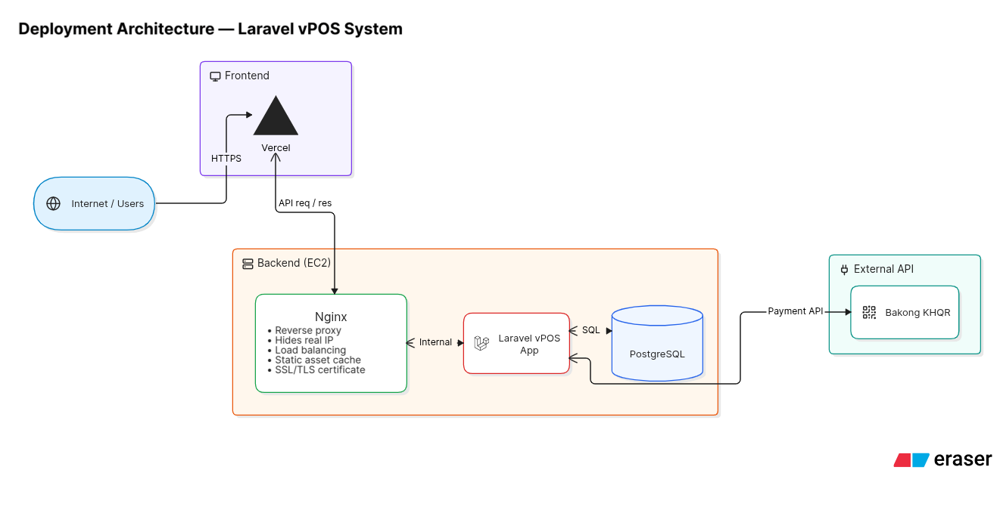
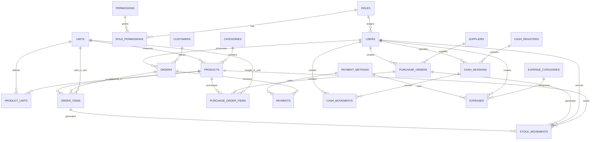

# vPOS

## Point-of-sale system for Cambodian mini-marts

vPOS is a focused point-of-sale platform for small retailers. The MVP supports fast checkout, cash and KHQR payments, inventory control, purchasing, expenses, cash-shift reconciliation, and operational reporting.

The initial release targets one store. The data model and service boundaries should remain ready for multi-store expansion without adding unnecessary complexity to the MVP.

## Table of Contents

- [Overview](#overview)
- [Key Capabilities](#key-capabilities)
- [Architecture](#architecture)
- [Database ERD](#database-erd)
- [Technology Stack](#technology-stack)
- [Getting Started](#getting-started)
- [Quality and Security](#quality-and-security)
- [Senior Review Notes](#senior-review-notes)
- [Documentation](#documentation)
- [Project Conventions](#project-conventions)

## Overview

| Area           | Decision                                                                      |
| -------------- | ----------------------------------------------------------------------------- |
| Product        | POS and back-office operations for a Cambodian mini-mart                      |
| MVP footprint  | One store, with multi-store extension points preserved                        |
| Primary users  | Admin, manager, and cashier                                                   |
| Payments       | Cash, card, and Bakong KHQR through a payment gateway boundary                |
| Currency       | USD by default, with KHR support                                              |
| Data integrity | PostgreSQL transactions, stock movement history, and auditable cash movements |

## Key Capabilities

- Product catalog, categories, units, suppliers, and stock movement history
- Barcode-friendly checkout with discounts, VAT, payment collection, change, and receipts
- Order history, refunds, returns, and customer records
- Purchase orders and stock receiving
- Cash registers, cashier shifts, cash in/out, and closing variance
- Expense categories and business expenses
- Role-based permissions for admin, manager, and cashier workflows
- Operational reports with PDF and spreadsheet export planned for the MVP

## Architecture

### Deployment architecture

The following diagram is the proposed deployment view for review. It shows the browser-facing frontend, the EC2 backend boundary, PostgreSQL, Nginx, and the Bakong KHQR payment API.



### Application architecture

The application is currently designed as a server-rendered Laravel monolith. Blade renders the main pages, Alpine.js supports focused client-side interactions, and JSON endpoints serve POS-specific operations. Controllers remain thin; validation, authorisation, business actions, and persistence have separate responsibilities.

See [System Architecture](docs/05-system-architecture.md) for layer responsibilities, security controls, performance guidance, and deployment recommendations.

## Database ERD

The ERD below shows the core relationships across access control, catalog, sales, purchasing, inventory, cash management, and finance. The detailed data dictionary, constraints, proposed fields, and column types are maintained in [Database Design](docs/04-database-design.md).



**Review rule:** the database schema and [Database Design](docs/04-database-design.md) remain the source of truth. Update this diagram whenever a table or relationship changes.

## Technology Stack

| Layer    | Technology                                                     |
| -------- | -------------------------------------------------------------- |
| Backend  | Laravel 13 and PHP 8.3+                                        |
| ORM      | Eloquent                                                       |
| Database | PostgreSQL                                                     |
| Frontend | Blade, Tailwind CSS, and Alpine.js where interaction is needed |
| Payments | Bakong KHQR behind a payment gateway interface                 |
| Testing  | Pest and Laravel feature tests                                 |
| Tooling  | Composer, npm, Vite, and Laravel Pint                          |

## Getting Started

### Requirements

- PHP 8.3 or newer
- Composer
- Node.js and npm
- PostgreSQL

### Installation

```bash
git clone <repository-url>
cd vPOS
composer run setup
```

Configure the generated `.env` file with the PostgreSQL connection and application settings before running the application. Never commit credentials, payment keys, or production configuration.

### Local development

```bash
composer run dev
```

The setup script installs PHP and JavaScript dependencies, creates the application key, runs migrations, and builds frontend assets.

### Verification

```bash
composer test
vendor/bin/pint --dirty --format agent
```

Run the narrowest relevant test file while developing, then run the full suite before review.

## Quality and Security

- Recalculate prices, discounts, tax, and payment totals on the server.
- Wrap multi-table sales, refunds, stock updates, and cash movements in database transactions.
- Lock product rows during checkout to prevent overselling.
- Enforce authentication, active-user checks, permissions, and resource policies.
- Protect non-GET requests with CSRF validation and validate uploads by type and size.
- Keep payment credentials in environment variables and exclude them from logs and source control.
- Record sensitive operational changes, including refunds, price changes, stock adjustments, and role changes.
- Back up PostgreSQL daily, retain backups off the application host, and test restoration regularly.

## Senior Review Notes

| Topic                 | Current position                                                                              | Review decision needed                                                                               |
| --------------------- | --------------------------------------------------------------------------------------------- | ---------------------------------------------------------------------------------------------------- |
| Frontend deployment   | The diagram shows Vercel, while the application documentation describes Blade-rendered pages. | Confirm whether Vercel is a target split frontend or whether the Laravel app serves the UI directly. |
| Backend hosting       | EC2 with Nginx, PHP-FPM, Laravel, and PostgreSQL is shown in the diagram.                     | Confirm ownership of patching, monitoring, scaling, and database operations.                         |
| Payment integration   | Bakong KHQR is represented as an external dependency behind a payment boundary.               | Confirm callback verification, timeout handling, idempotency, and reconciliation ownership.          |
| Data protection       | Roles, permissions, auditability, and backups are required.                                   | Confirm retention, restore objectives, and access to production data.                                |
| Operational readiness | Staging and production environments are expected.                                             | Define deployment approval, rollback, health checks, alerts, and release evidence.                   |

The deployment image is intentionally retained as a review artifact. Its frontend split should be reconciled with the application architecture before production implementation.

## Documentation

| #   | Document                                                        | Purpose                                                   |
| --- | --------------------------------------------------------------- | --------------------------------------------------------- |
| 01  | [Project Overview](docs/01-project-overview.md)                 | Purpose, users, scope, assumptions, and success criteria  |
| 02  | [Functional Requirements](docs/02-functional-requirements.md)   | Required behavior for each module                         |
| 03  | [Business Rules](docs/03-business-rules.md)                     | Pricing, stock, cash, status, and validation rules        |
| 04  | [Database Design](docs/04-database-design.md)                   | Tables, relationships, indexes, and known gaps            |
| 05  | [System Architecture](docs/05-system-architecture.md)           | Application layers, security, performance, and deployment |
| 06  | [User Roles and Permissions](docs/06-user-roles-permissions.md) | Access boundaries by role                                 |
| 07  | [Workflows](docs/07-workflows.md)                               | Checkout, refunds, shifts, and purchasing flows           |
| 08  | [UI/UX Guidelines](docs/08-ui-ux-guidelines.md)                 | Interface and component standards                         |
| 09  | [API and Validation](docs/09-api-and-validation.md)             | Routes, endpoints, validation, and error handling         |
| 10  | [Testing Strategy](docs/10-testing-strategy.md)                 | Coverage priorities and critical test cases               |
| 11  | [Development Roadmap](docs/11-development-roadmap.md)           | Milestones, sequencing, and delivery risks                |

## Project Conventions

- The ERD and schema in [Database Design](docs/04-database-design.md) are the source of truth for persisted data.
- Requirement IDs use `FR-*` for functional requirements, `BR-*` for business rules, and `NFR-*` for non-functional requirements.
- `MUST`, `SHOULD`, and `COULD` indicate MVP priority.
- `Proposed` identifies a recommendation that is not yet part of the current schema or implementation.
- Store money as `decimal`, never floating-point values.
