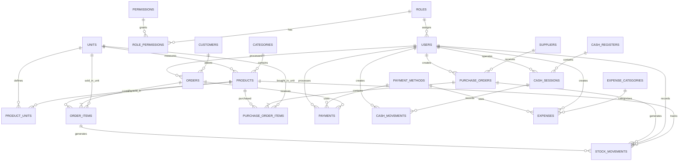

# 04 · Database Design

PostgreSQL. This document describes the current ERD (19 tables), plus two tables for units of measure (`units`, `product_units`) and the unit columns they require. Unit additions are marked **Proposed** because they are not in the ERD image yet; update the diagram when you adopt them. Laravel adds `created_at` and `updated_at` to every table; they are omitted from the dictionaries below for brevity.

## 1. Domain Map

| Domain         | Tables                                                              |
| -------------- | ------------------------------------------------------------------- |
| Access control | `roles`, `permissions`, `role_permissions`, `users`                 |
| Catalog        | `categories`, `products`, `units`, `product_units`                  |
| Sales          | `customers`, `orders`, `order_items`, `payments`, `payment_methods` |
| Purchasing     | `suppliers`, `purchase_orders`, `purchase_order_items`              |
| Inventory      | `stock_movements`                                                   |
| Cash           | `cash_registers`, `cash_sessions`, `cash_movements`                 |
| Finance        | `expense_categories`, `expenses`                                    |

## 2. Relationships

## 3. Data Dictionary

Legend: **PK** primary key · **FK** foreign key · **UK** unique

### Access control

**roles**
| Column | Type | Key | Notes |
|--------|------|-----|-------|
| id | bigint | PK | |
| name | string | UK (proposed) | Admin, Manager, Cashier |
| description | text | | |

**permissions**
| Column | Type | Key | Notes |
|--------|------|-----|-------|
| id | bigint | PK | |
| module | string | | e.g. `products`, `orders` |
| action | string | | e.g. `view`, `create`, `update`, `delete`, `refund` |

Unique on (`module`, `action`) (proposed).

**role_permissions**
| Column | Type | Key | Notes |
|--------|------|-----|-------|
| id | bigint | PK | |
| role_id | bigint | FK → roles.id | |
| permission_id | bigint | FK → permissions.id | |

Unique on (`role_id`, `permission_id`) (proposed).

**users**
| Column | Type | Key | Notes |
|--------|------|-----|-------|
| id | bigint | PK | |
| role_id | bigint | FK → roles.id | |
| name | string | | |
| email | string | UK (proposed) | |
| phone | string | | |
| password | string | | hashed |
| status | string | | `active`, `inactive` |

### Catalog

**categories**: `id` PK · `name` · `description` (text) · `status`

**units** (**Proposed**)
| Column | Type | Key | Notes |
|--------|------|-----|-------|
| id | bigint | PK | |
| name | string | UK | Piece, Box, Kilogram ... (case-insensitive unique) |
| abbreviation | string | UK | pcs, box, kg, L ... |
| type | string | | `count`, `weight`, `volume`, `length`, `other` (informational, used for grouping) |
| allow_decimal | boolean | | `false` for piece or box, `true` for kg or liter |
| status | string | | `active`, `inactive` |

**product_units** (**Proposed**): alternate units for a product. The base unit lives on `products.unit_id` and is not repeated here.
| Column | Type | Key | Notes |
|--------|------|-----|-------|
| id | bigint | PK | |
| product_id | bigint | FK → products.id | `cascade` on delete |
| unit_id | bigint | FK → units.id | must differ from the product's base unit |
| conversion_factor | decimal(14,4) | | base units in one of this unit; greater than 0 |
| barcode | string | UK | nullable; lets a scanned pack barcode add the pack unit |
| price | decimal | | nullable; when null, price = `products.price × conversion_factor` |

Unique on (`product_id`, `unit_id`).

**products**
| Column | Type | Key | Notes |
|--------|------|-----|-------|
| id | bigint | PK | |
| category_id | bigint | FK → categories.id | |
| unit_id | bigint | FK → units.id | **Proposed.** Base unit. `stock`, `min_stock`, `cost` and `price` are all per this unit |
| name | string | | |
| sku | string | UK | |
| barcode | string | UK | nullable |
| cost | decimal | | latest purchase cost per base unit, `decimal(14,4)` |
| price | decimal | | selling price per base unit |
| stock | decimal | | denormalised on-hand quantity, in base unit |
| min_stock | decimal | | low-stock threshold |
| image | string | | file path |
| status | string | | `active`, `inactive` |

### Sales

**customers**: `id` PK · `name` · `phone` · `email` · `address` (text) · `notes` (text) · `status`

**payment_methods**
| Column | Type | Key | Notes |
|--------|------|-----|-------|
| id | bigint | PK | |
| name | string | | Cash, KHQR, Card |
| code | string | UK | `cash`, `khqr`, `card` |
| is_enabled | boolean | | |

**orders**
| Column | Type | Key | Notes |
|--------|------|-----|-------|
| id | bigint | PK | |
| order_number | string | UK | |
| customer_id | bigint | FK → customers.id | nullable (walk-in) |
| cashier_id | bigint | FK → users.id | |
| status | string | | see 03 §3 |
| subtotal | decimal | | |
| discount_percent | decimal | | 0, 5, 10, 15 |
| discount_amount | decimal | | |
| tax_rate | decimal | | snapshot |
| tax_amount | decimal | | |
| total | decimal | | |
| placed_at | timestamp | | set at completion |

**order_items**
| Column | Type | Key | Notes |
|--------|------|-----|-------|
| id | bigint | PK | |
| order_id | bigint | FK → orders.id | |
| product_id | bigint | FK → products.id | |
| quantity | decimal | | in the sold unit |
| unit_id | bigint | FK → units.id | **Proposed.** Unit sold (base or alternate) |
| conversion_factor | decimal | | **Proposed.** Snapshot; 1 when sold in the base unit |
| unit_price | decimal | | snapshot, per sold unit |
| unit_cost | decimal | | snapshot per sold unit, used for profit |
| line_total | decimal | | |

`base_quantity = quantity × conversion_factor` is derived (Eloquent accessor, or a generated column if you prefer to query it directly).

**payments**
| Column | Type | Key | Notes |
|--------|------|-----|-------|
| id | bigint | PK | |
| order_id | bigint | FK → orders.id | |
| payment_method_id | bigint | FK → payment_methods.id | |
| processed_by | bigint | FK → users.id | |
| amount | decimal | | |
| refunded_amount | decimal | | default 0 |
| reference | string | | bank transaction ID |
| status | string | | see 03 §4 |
| paid_at | timestamp | | |

### Purchasing

**suppliers**: `id` PK · `name` · `phone` · `email` · `address` (text) · `status`

**purchase_orders**
| Column | Type | Key | Notes |
|--------|------|-----|-------|
| id | bigint | PK | |
| supplier_id | bigint | FK → suppliers.id | |
| created_by | bigint | FK → users.id | |
| purchase_number | string | UK | |
| status | string | | `draft`, `ordered`, `received`, `cancelled` |
| total | decimal | | |
| ordered_at | timestamp | | |

**purchase_order_items**: `id` PK · `purchase_order_id` FK · `product_id` FK · `quantity` (in the purchased unit) · `unit_id` FK (**Proposed**) · `conversion_factor` (**Proposed**, snapshot) · `unit_cost` (per purchased unit) · `line_total`

### Inventory

**stock_movements**
| Column | Type | Key | Notes |
|--------|------|-----|-------|
| id | bigint | PK | |
| product_id | bigint | FK → products.id | |
| user_id | bigint | FK → users.id | who caused it |
| purchase_order_id | bigint | FK → purchase_orders.id | nullable |
| order_item_id | bigint | FK → order_items.id | nullable |
| type | string | | `purchase`, `sale`, `return`, `adjustment`, `damage` |
| quantity | decimal | | signed, always in the product's base unit |
| balance | decimal | | stock after movement, in base unit |
| reference | string | | |
| note | text | | required for adjustments |

### Cash

**cash_registers**: `id` PK · `name` · `status`

**cash_sessions**
| Column | Type | Key | Notes |
|--------|------|-----|-------|
| id | bigint | PK | |
| cash_register_id | bigint | FK → cash_registers.id | |
| user_id | bigint | FK → users.id | cashier |
| opening_float | decimal | | |
| closing_amount | decimal | | counted at close |
| expected_amount | decimal | | calculated at close |
| opened_at | timestamp | | |
| closed_at | timestamp | | null while open |

**cash_movements**
| Column | Type | Key | Notes |
|--------|------|-----|-------|
| id | bigint | PK | |
| cash_session_id | bigint | FK → cash_sessions.id | |
| user_id | bigint | FK → users.id | |
| type | string | | `cash_in`, `cash_out` |
| reason | string | | |
| amount | decimal | | always positive |

### Finance

**expense_categories**: `id` PK · `name`

**expenses**
| Column | Type | Key | Notes |
|--------|------|-----|-------|
| id | bigint | PK | |
| expense_category_id | bigint | FK → expense_categories.id | |
| created_by | bigint | FK → users.id | |
| payment_method_id | bigint | FK → payment_methods.id | |
| description | string | | |
| amount | decimal | | |
| expense_date | date | | |

## 4. Column Types (recommended)

| Kind                                                          | PostgreSQL type                                     |
| ------------------------------------------------------------- | --------------------------------------------------- |
| Money                                                         | `decimal(14,2)`                                     |
| Quantity                                                      | `decimal(14,3)`                                     |
| Conversion factor                                             | `decimal(14,4)`                                     |
| Cost per base unit (`products.cost`, snapshotted `unit_cost`) | `decimal(14,4)`                                     |
| Percent                                                       | `decimal(5,2)`                                      |
| Status / type                                                 | `string(30)` + PHP backed enum + `CHECK` constraint |
| Primary / foreign keys                                        | `bigint` (`foreignId()->constrained()`)             |

## 5. Indexes (recommended)

| Table           | Index                                                                                                           | Purpose                                 |
| --------------- | --------------------------------------------------------------------------------------------------------------- | --------------------------------------- |
| products        | `sku` UK, `barcode` UK, `(category_id, status)`, `name` (trigram optional)                                      | Scan, search, filter                    |
| orders          | `order_number` UK, `(status, placed_at)`, `cashier_id`, `customer_id`                                           | Lists and reports                       |
| order_items     | `order_id`, `product_id`                                                                                        | Joins, top-product reports              |
| payments        | `order_id`, `(payment_method_id, paid_at)`                                                                      | Daily summaries                         |
| stock_movements | `(product_id, created_at)`                                                                                      | Product history                         |
| cash_sessions   | partial unique `(user_id) WHERE closed_at IS NULL`, partial unique `(cash_register_id) WHERE closed_at IS NULL` | Enforces BR-CSH-01/02                   |
| expenses        | `(expense_date, expense_category_id)`                                                                           | Reports                                 |
| units           | `lower(name)` UK, `lower(abbreviation)` UK                                                                      | Case-insensitive uniqueness (BR-UNT-02) |
| product_units   | `(product_id, unit_id)` UK, `barcode` UK (partial, where not null)                                              | One row per unit, scan by pack barcode  |
| products        | `unit_id`                                                                                                       | Unit usage lookups and delete checks    |

## 6. Delete Behaviour

| Relation                                                                    | On delete                                           |
| --------------------------------------------------------------------------- | --------------------------------------------------- |
| Anything with transactional history (users, products, customers, suppliers) | `restrict`; deactivate through `status`             |
| order → order_items                                                         | `cascade` (only possible for `pending` orders)      |
| purchase_order → purchase_order_items                                       | `cascade` (only for `draft`)                        |
| role → role_permissions                                                     | `cascade`                                           |
| role → users                                                                | `restrict`                                          |
| unit → products, product_units, order_items, purchase_order_items           | `restrict`; deactivate through `status` (BR-UNT-12) |
| product → product_units                                                     | `cascade`                                           |

## 7. Gaps and Proposed Additions

The ERD covers the MVP flow well. These items are missing and affect behaviour described in other documents:

| #   | Gap                                    | Proposed change                                                                                                         | Why                                                                                                                       |
| --- | -------------------------------------- | ----------------------------------------------------------------------------------------------------------------------- | ------------------------------------------------------------------------------------------------------------------------- |
| 1   | No link between an order and a shift   | Add `orders.cash_session_id` (FK, nullable)                                                                             | Per-shift sales totals and drawer reconciliation (BR-CSH-04)                                                              |
| 2   | No currency on payments                | Add `payments.currency` (`USD`/`KHR`), `payments.exchange_rate`, `payments.amount_tendered`                             | KHR payments and change calculation                                                                                       |
| 3   | No returns structure                   | Add `order_refunds` (id, order_id, payment_id, user_id, amount, reason, restocked) and `order_refund_items`             | Refunds are only visible as `refunded_amount` today; item-level returns and reasons are lost                              |
| 4   | No settings storage                    | Add `settings` (key, value)                                                                                             | Business profile, VAT, exchange rate, receipt text                                                                        |
| 5   | No audit trail                         | Add `activity_logs` (user_id, action, subject_type, subject_id, properties jsonb)                                       | Refunds, price edits, stock adjustments (FR-SET-04)                                                                       |
| 6   | `purchase_orders` has no receive date  | Add `received_at`, `received_by`                                                                                        | Audit, and date-based stock reports                                                                                       |
| 7   | Soft deletes absent                    | Add `deleted_at` on catalog tables if hard delete is ever needed                                                        | Safer than cascading                                                                                                      |
| 8   | Multi-store later                      | Add nullable `store_id` on orders, products stock, cash_registers, users                                                | Keep out of MVP, but avoid decisions that block it                                                                        |
| 9   | `expenses.payment_method_id` vs drawer | Add optional `expenses.cash_session_id`                                                                                 | Lets cash expenses reduce expected drawer cash                                                                            |
| 10  | `products.stock` is denormalised       | Keep it, but add a scheduled check that compares it with the latest `stock_movements.balance`                           | Detects drift early                                                                                                       |
| 11  | No unit of measure anywhere in the ERD | Add `units`, `product_units`, `products.unit_id`, and unit columns on `order_items` and `purchase_order_items` (see §3) | Stores sell in different units (pieces, boxes, kg, liters) and weighed goods need decimals. Required before the POS phase |

## 8. Default Units Seed

Seeded once at install. Stores can edit, deactivate, or add their own.

| Name       | Abbreviation | Type   | Allow decimal |
| ---------- | ------------ | ------ | :-----------: |
| Piece      | pcs          | count  |      no       |
| Box        | box          | count  |      no       |
| Pack       | pack         | count  |      no       |
| Bottle     | btl          | count  |      no       |
| Can        | can          | count  |      no       |
| Bag        | bag          | count  |      no       |
| Carton     | ctn          | count  |      no       |
| Gram       | g            | weight |      yes      |
| Kilogram   | kg           | weight |      yes      |
| Milliliter | ml           | volume |      yes      |
| Liter      | L            | volume |      yes      |
| Meter      | m            | length |      yes      |
