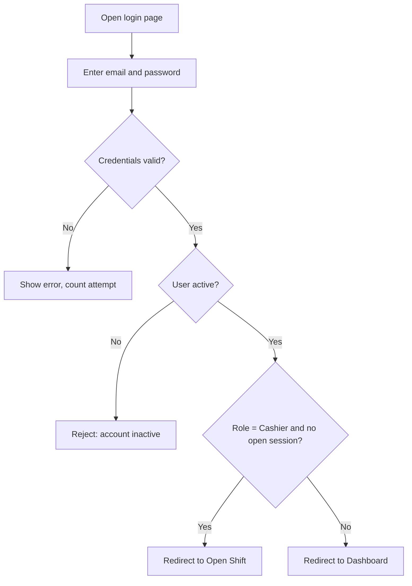
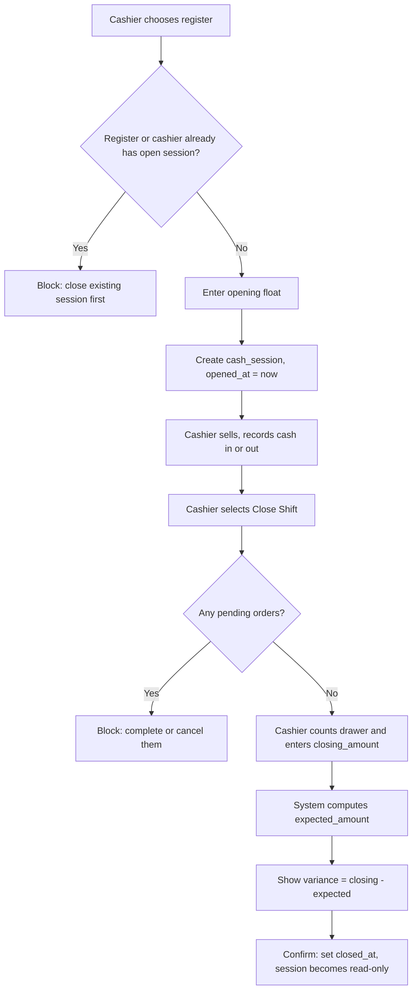
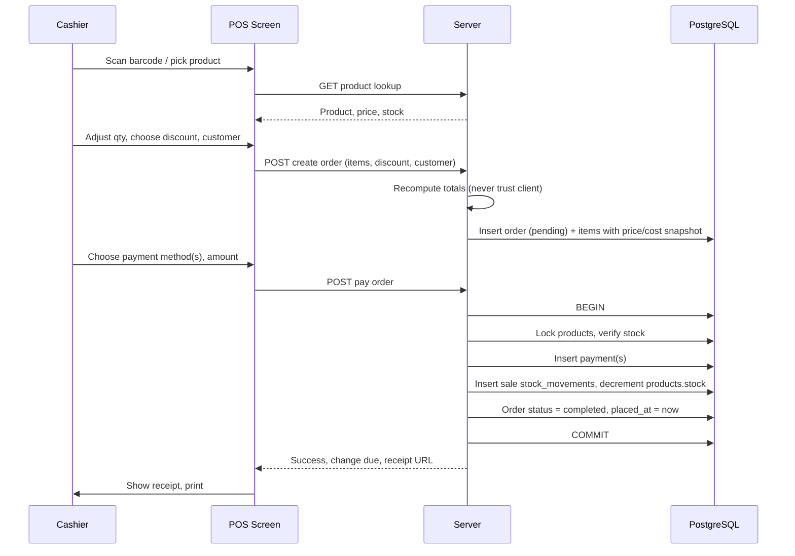
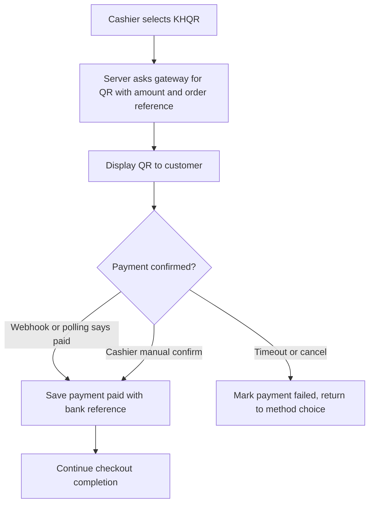
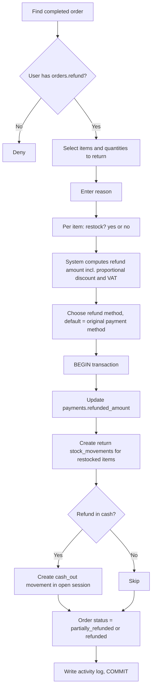
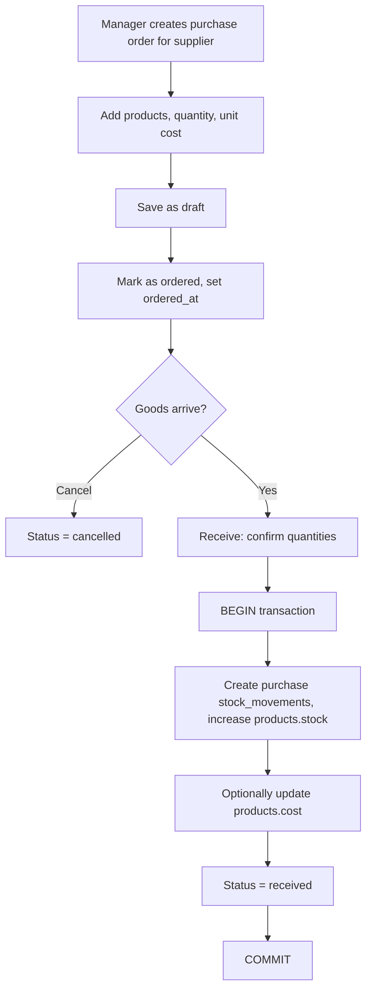

# 07 · Workflows

All diagrams use Mermaid. Every multi-table step runs inside one database transaction.

## 1. Sign-in

## 2. Open and Close a Shift

## 3. Checkout (core flow)

**Failure handling**

| Situation | Behaviour |
|-----------|-----------|
| Insufficient stock at pay time | Roll back, show which item, keep cart |
| KHQR not confirmed | Order stays `pending`, payment `pending`; cashier can retry or switch method |
| Payment total less than due | Order stays `pending`; remaining balance shown |
| Server error | Roll back whole transaction; nothing is half-saved |

## 4. KHQR Payment

## 5. Refund / Return

## 6. Purchase and Receive Stock

## 7. Manual Stock Adjustment

1. Manager opens a product, selects **Adjust stock**.
2. Enters the new counted quantity or a signed difference.
3. Chooses type (`adjustment` or `damage`) and writes a required note.
4. Server creates one stock movement with the signed difference and updates `products.stock`.
5. Entry is written to the activity log.

## 8. Record an Expense

1. User with `expenses.create` opens the form.
2. Chooses category, payment method, amount, date, description.
3. Server saves the expense with `created_by`.
4. If paid in cash from an open drawer, the expense is linked to the session (**Proposed**, 04 §7 item 9) and reduces expected cash.

## 9. Daily Closing (Manager)

1. Confirm all sessions for the day are closed.
2. Review variances per session.
3. Review sales summary, payment-method breakdown, refunds, expenses.
4. Export the daily report to PDF or Excel.
